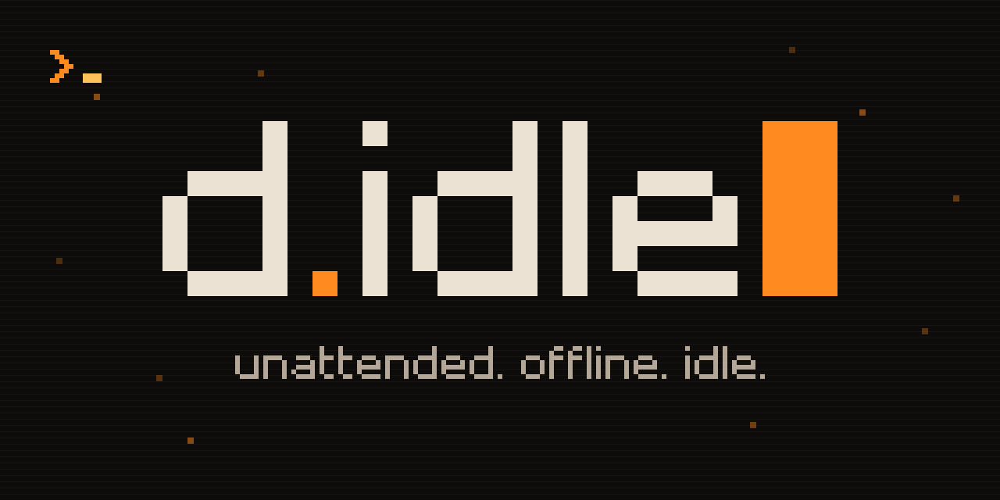

<p align="center"></p>

# d2lod-bot (d.idle)

Chat and help: the [d.idle Discord](https://discord.gg/U2v9q4h5UH).

A bot that plays one character of classic **Diablo II: Lord of Destruction 1.14d**, offline single player, on a game you own
and run yourself. Written in Go (standard library only). It reads the game's memory, decides what to do (level, quest, farm,
shop, survive), and sends ordinary mouse and keyboard input. The idle-game layer on top of it (upgrades, prestige, a public
status page and stream) is called **d.idle**; it is parked until the bot plays well.

## Status

Early, honest, and measured rather than promised. The bot runs on d2d (the primary backend) in a lockstep lab. A Sorceress
levels through Normal Act 1 unattended: the last 2 h unattended soak reached level 13 with no deaths (one injected d2d kill
recovered; per-hour numbers and caveats are in `docs/probes/postfix-soak1.md`, a single run, not a statistical claim). The
basic game primitives (belt, pickup, town portals, waypoints, shopping, repair, stash, merc revive, equip, save and rejoin)
are checked by a live drill suite (`cmd/d2drill`, `docs/primitives.md`, `docs/probes/drills/`) on hidden game instances; some
drills still fail or are blocked, and the drill reports say which.

Still unproven: monster fights beyond early Act 1, quests, Acts 2 to 5, Nightmare and Hell (code and offline simulations only),
and classes other than the Sorceress (short smoke runs). The fidelity gap between d2d and the original game is measured, not
claimed closed (`docs/d2d-baselines-early.md`). The current state is always in `docs/plan/STATUS.md` (generated), the
day-by-day notes in `CHANGELOG.md`, and the entry point for everything else is `docs/INDEX.md`.

## How it runs: two backends

- **d2d (primary).** [d2decomped](https://github.com/psi29a/d2decomped) is an open-source, native reimplementation of the
  1.14d engine. The bot talks to it over its local control socket as a separate program; no Wine. This is the supported path
  and the one the container uses (`deploy/container/`, `docs/d2d-container/`; ADR 0009 in `docs/adr/`).
- **Original Game.exe under Wine (reference).** The path the bot grew up on. It is frozen as a reference: no new features, and
  the old 2 h and 8 h Game.exe gate soaks are retired in favour of the same gates on d2d (ADR 0013, spec
  `openspec/specs/soak-gates/spec.md`, "d2d gate ladder" in `docs/review-strategy.md`).

In both cases **you supply your own Diablo II install**. Nothing Blizzard owns is in this repository, downloaded, or mirrored,
and the bot never touches Battle.net or chat. Our fixes to d2d are offered to its maintainer upstream as small, proven pull
requests; this repo contains no d2d code.

## How we check it

- **Drills (Gate 0):** scripted live checks of each basic primitive on a hidden d2d slot with a throwaway character.
- **Soak ladder:** 2 h, then 8 h, then 24 h unattended runs on one build, judged by the gates in the soak-gates spec.
- **Differential proofs:** any change to d2d is checked against the original game's own code running under an emulator
  (`tools/emu`, `docs/research/`), not against our assumptions.

## Quick start (safe, offline)

```sh
go version            # Go 1.27 or newer (go.mod's `go 1.24` is only the language floor)
go build ./...        # standard library only, no network
go test ./internal/... # unit tests run against recorded snapshots, no game needed
```

Running the bot against a real game: `docs/quickstart.md` (user guide) and `docs/container.md` (the container). Expect rough
edges; the guides say what has been verified on a stranger's machine and what has not.

## Layout

| path | what |
|---|---|
| `cmd/` | binaries: `d2bot` (the bot and its dashboard), `d2fleet` (many bots), `d2soak` and `d2dsoak` (long-run verdicts), `d2drill` (live drill suite), `d2dview` (game view), tools |
| `internal/` | packages: memory reading, input, navigation, combat, town, leveling, gear, merc, API; `internal/drill` holds the drills |
| `web/` | dashboard front end (embedded) |
| `deploy/`, `packaging/` | container files and a NAS app template |
| `openspec/` | contracts (`specs/`) and the change cards every piece of work is briefed and tracked with |
| `docs/` | design, evidence and research notes; `docs/INDEX.md` is the map; `docs/research/` and `docs/probes/` hold traces, drill and soak reports |
| `tools/` | developer and maintainer scripts (some assume the maintainer's lab and are documented as such); `tools/emu` is the emulator harness |

## Contributing: agents first

This repo is developed mostly by AI coding agents working from written briefs. Every job is a change card in
`openspec/changes/<id>/` with the paths it owns and the gates it must pass; `AGENTS.md` holds the rules those agents (and
humans) follow, and `GLOSSARY.md` the vocabulary. If you want to contribute:

- open an issue or a pull request against `main`; describe what you verified and how (live run, unit test, or neither);
- tag every game fact you rely on as verified or unverified, like the rest of the docs do;
- do not add game files, extracted tables beyond what `THIRD_PARTY.md` allows, decompiled code, or anything that talks to Battle.net;
- keep to the Go standard library;
- the project name is styled **d.idle**, lowercase d.

Chat and help: the [d.idle Discord](https://discord.gg/U2v9q4h5UH). Rules and FAQ are pinned there.

This repository is the working repository: pull requests are merged here directly. Its history starts at an initial snapshot; the working history before it is kept privately.
Read the rules in `AGENTS.md` (agents first, upstream style: small changes, tagged facts, no game data) before you open a pull request.
How CI works, in one line: every push to `main` and every pull request runs `.github/workflows/ci.yml` (changecheck, leakcheck, hygiene, gofmt/vet, then the short tests); a `v*` tag also builds and publishes the release tarball.
Maintainer-only operations material (lab hosts, status board, publishing) lives elsewhere and is not needed to build, test or contribute.

## Licence

GPL-3.0-or-later, same as d2d (ADR 0010); see `LICENSE`. Third-party code and provenance: `THIRD_PARTY.md`.
Diablo II is a trademark of Blizzard Entertainment; this project is not affiliated with or endorsed by Blizzard.
