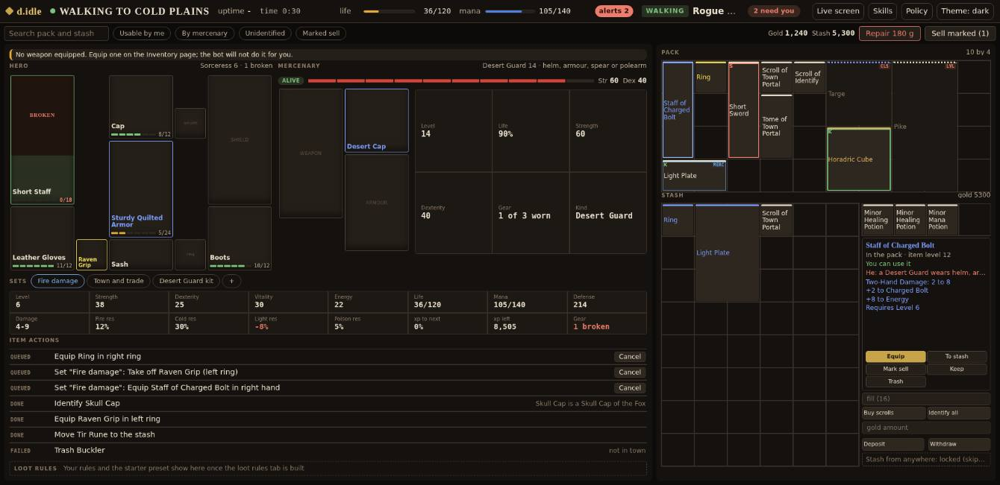
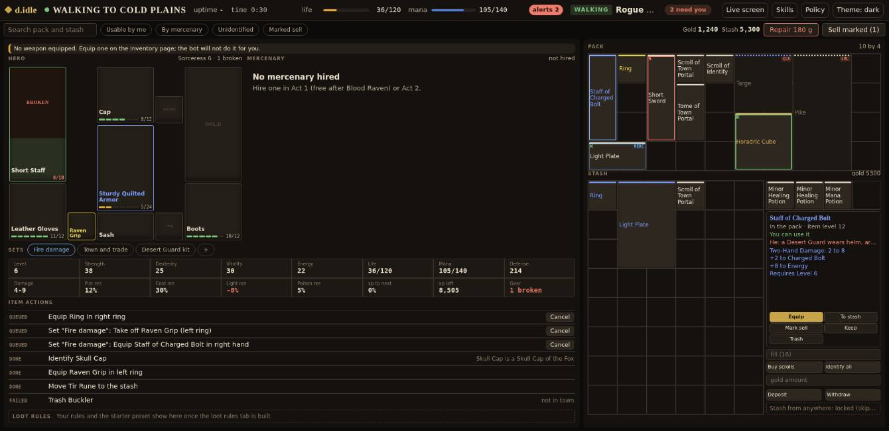
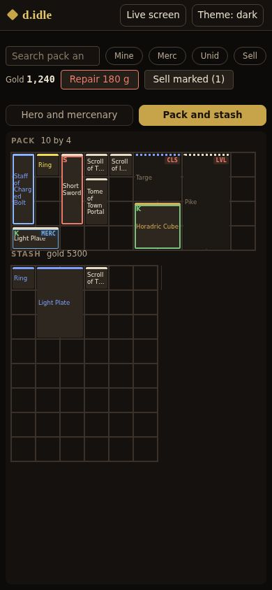
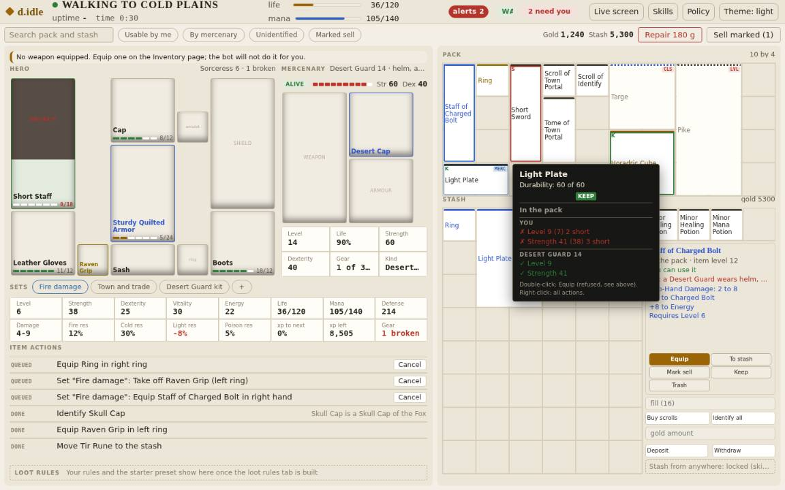

# Review of the merged character screen: C2 (canvas) and C3 (tooltip, menu, gestures, feedback)

> status: review of `origin/main` at `4996d53af` (cards TASK-456 uic2 and TASK-463 uic3, both merged), 2026-11-15. Reviewer: the design reviewer named in [../briefs/README.md](../briefs/README.md) ("What Fable reviews"). Read-only on code. Nothing here ran against a live game, the sandbox or a deployed viewer: every picture is of the fixture viewer (`tools/uishots serve`) in headless Chromium on the builder. Tags: V = seen in a render named here, run, or computed; S = read in code, not run; U = unverified.

## Verdict: APPROVE WITH CHANGES

On a desktop window with a living mercenary the page is what the user asked for: one frame on one cell unit, the hero and the mercenary side by side, pack over stash, a real tooltip, a right-click menu, set chips, gold and repair as chips. It fits all eight sizes with the default fixture (V: `tools/uishots.sh --fit --only 'character*'` on the builder, every line ok) and it is close to the accepted render at 1440x900. The requirement display obeys the view and a refusal never takes the done look (V: `TestUIC3TooltipMenuGestures`, section 3).

It is not done. Fourteen things must change (R14 is the check itself) before the page is shown to the user as finished or the instant lane is switched on. Three of them are the user's own rejection reason coming back (dead space: R3, R4, R5), two make the phone unusable (R1, R2), and one means the pending state the whole feedback design rests on is not visible on the default (queue) path (R6). The fit check passed all of it, so the check needs the fixtures of R14 too.

The page keeps `?view=classic` (V: render, the cards page still works), and the older tests pass (section 7), so nothing here calls for a revert.

*1914x930, the size of the user's first look. The mercenary's six values fill a 445 by 315 px block (R4); the selected box has an empty band over its buttons (R5).*

## Required changes

| # | Where | What is wrong | Change |
|---|---|---|---|
| R1 | `internal/watch/web/inventory-canvas.css:223` (`.cv-storez { align-items: flex-start }`), `:222` | On the phone the Pack and stash tab has no belt, no selected item box, no town errands and no message line. The zone shrinks `.cv-store` to its content, so its `minmax(0, 1fr)` column is 0 px wide. V: [c2c3/char-390x844-pack.jpg](c2c3/char-390x844-pack.jpg), also with a full pack. The accepted phone render has the belt and the selected box under the stash. With R11 this leaves a phone with no way to act on an item | Drop the `align-items` (or give `.cv-store` the full width) and lay the side column out as the accepted render does (belt, selected box, errands under the stash; the storage tab scrolls inside itself, J section 4 "Widths") |
| R2 | `inventory-canvas.js:372` (`Math.ceil(t.length / 2)` columns), `inventory-canvas.css:135` | The hero sheet is two rows of eight at every width. At 390 px a tile is 45 px wide: labels read "L...", "St...", values "3...", "1...". V: [c2c3/char-390x844-hero.jpg](c2c3/char-390x844-hero.jpg). The brief (C2 item 2) says four columns | Four columns under 700 px (four rows); keep eight on the desktop |
| R3 | `inventory-canvas.css:91` (`.cv-wear`), `inventory-merc.js:120-123`, `:159` | No mercenary: the column says "No mercenary hired" and the rest is empty, about 700 by 330 px at 1914x930. A view without a `merc` block hides the column and leaves the same hole. Every new hero has no mercenary, so this is the first thing a fresh character shows. V: render below, and `absentmerc` at 1440x900 | When there is no doll to draw (none, absent, unknown) the who zone reflows: the hero sheet goes beside the doll (four by four), the "not hired, hire one in Act 1 or 2" text is one line in the label row, the item actions get the freed height |
| R4 | `inventory-canvas.css:138`, `:145` (`block-size: calc(5 * var(--mu))`, rows `minmax(0, 1fr)`) | The mercenary's six values are stretched to fill his column: tiles of 148 by 157 px holding "Level 14" at 1914x930, 120 by 95 px at 1280x620. That is dead space with a border. At 1920x1080 his column is too narrow for that variant, the tiles sit under the doll and about 175 by 300 px beside the doll is empty instead. V: render above, `base-1920x1080` | Give his tiles the hero tiles' height (`:135`) and use the rest for something he lacks today: his worn items by name, the `actWhy` line, or more item-action rows |
| R5 | `inventory-canvas.js:236-252`, `:271-279`, `inventory-canvas.css:167` | The selected box. (a) An empty band above the buttons: about 145 px for an item without properties at 1914x930, 70 px with four properties (the gap C2 flagged). (b) The verdict lines are one line with an ellipsis, so "You: needs 41 strength (you have ..." loses the number; the mercenary line has no `title` (`:278`). (c) It builds its own action list instead of the menu's: other labels ("To stash" against "Move to stash"), no Give to mercenary, no Repair now, no queued row with Cancel, and it calls `equip` without the menu's "queued to be trashed" check. The accepted render shows both wearers' requirement rows and the mercenary button here. V: [c2c3/char-1914x930-dark.jpg](c2c3/char-1914x930-dark.jpg), `sel-plate16-1914x930` | One model: export the menu entries (`d2InvActions`, next to `first`) and the tooltip's `who` and `against` rows, draw those in the box with wrapping lines and, when there is room, the comparison. The gap closes and the three places can no longer disagree |
| R6 | `inventory.js:195` (the `d2:inventory` event is sent before `doll()` and `cells()` rebuild), `inventory-actions.js:426` (`markPending()` runs at once, on the old cells) | The pending outline and the `TOWN` badge are never on the cells after a repaint, and never on page load. V: a view with three queued requests and one `wait: town` shows no dashed cell and no badge ([c2c3/char-pending-crop.jpg](c2c3/char-pending-crop.jpg): Ring, Staff and Light Plate are all queued). On the default path (lane off) every action is queued: the dashed outline shows after the click and is gone at the next poll. The same repaint also wipes a `refused` or `done` mark early | Run `markPending()` and `markFeedback()` in the microtask that already redraws the queue (`:428`), as the canvas does (`inventory-canvas.js:416`). Add a DOM test that goes through `inventory.js` `paint` |
| R7 | `inventory-actions.js:159-165` (`refresh`) | After its own request the page fetches the view and hands it to the menu, the tooltip and the canvas, but `inventory.js` does not repaint the grids until its 4 s poll. With the lane on, `done` is drawn on an item that still sits in its old cell while the selected box already says the new place (S) | `inventory.js` repaints on `d2:inventory-fresh` |
| R8 | `inventory-canvas.css:17-19` | The band is forced to 44 px but the status panels in it are two lines: at 1536 px wide and below the panels wrap, the headline's top is cut and the life and mana rows are clipped. V: 1536x730, 1440x900, 1366x768, 1280x620 (visible in every desktop render here but the 1914 ones). The accepted render has one line: name, class and level, area | A one-line band for this page: hero, class and level, where; the needs chip; the links |
| R9 | `inventory-tip.css:33-35`, `:40-41` | The tooltip is black in both themes (`tokens.css:55`), but its requirement rows and deltas use `--d-good`, `--d-bad`, `--d-warn`, which in the light theme are dark colours for a light page: 3.5:1, 2.9:1 and 3.5:1 on the tip (V: computed; render below). The red "2 short" rows are the ones that matter | Tip tokens for these (`--d-tip-bad` exists; add good and warn) |
| R10 | `inventory-canvas.css:78` (`display: block` drops the line clamp of `components.css:170`), `inventory-canvas.js:328` (measures the slot, not the label) | A long name in a one-row slot (belt, ring, gloves) is clipped mid-line, no ellipsis; the fit harness reports it (`span.nm [83/28]`). Magic belts and gloves have such names. V: [c2c3/char-1440x900-full-long.jpg](c2c3/char-1440x900-full-long.jpg) | Cut the label against its own box (`cutText(n, n)`), keep the full name in the title |
| R11 | `inventory-drag.js:14`, `:240`; `inventory-actions.js:457` | Touch. A held finger starts a drag after 280 ms; Android sends `contextmenu` near 500 ms, which the drag script cancels as a default but the menu handler still acts on, so a sheet with a scrim opens under a drag. iOS sends no `contextmenu`: no menu at all. S (code), U on a device | No menu from `contextmenu` while `body[data-dragging]` or for a touch pointer; an explicit touch entry instead: an Actions button on the tooltip sheet, or the box's "More..." always present on a coarse pointer |
| R12 | `inventory-actions.js:515`, `:253-259`, `:272` | Delete opens the menu on the confirm step, but focus stays on the first available entry: the menu reads "Confirm: trash it" and Enter equips or identifies. After a click on Trash the focus sits on the confirm button itself, so a second Enter drops the item (S) | After the first step focus "Keep it" in both paths |
| R13 | `inventory-merc.js:124-135`, `inventory-canvas.css:99-106` | Dead mercenary with a Revive button: the header overflows (harness: `div.cv-mhead [334/268]` at 1440x900), the price is cut off, the life bar collapses, and Revive is not styled as the primary button (there is no `.cv-btn[data-primary]` rule). Nothing sends `merc.revive` today, so this is latent. V: [c2c3/char-1440x900-dead-revive.jpg](c2c3/char-1440x900-dead-revive.jpg) | Before B3 binds it: a dead header is chip, Revive with its price (primary), nothing else |
| R14 | `tools/uishots.sh` (fit pages `character*`), `tools/uishots/pages.go` (one fixed view), `tools/uishots/fit.js` | The fit check passed R1, R3, R4, R8, R10 and R13. It has one fixture and it does not see a content column of zero width or text cut by `overflow: hidden` in the band | Fixture variants for the fit pages: no mercenary, dead with revive, long names, full pack and stash, no hero stats. A panel child with content and zero width fails |

*R3: a hero without a mercenary at 1914x930.*

*R1: the phone's storage tab. The belt, the selected item and the errands are a 0 px column right of the stash.*

*R9: the tooltip in the light theme. Placement and content are right; the red rows are not readable enough.*

## 1. Layout against the accepted design

| Point | Finding |
|---|---|
| One unit | V: `--u` drives the dolls, pack, stash and belt at all eight sizes (38 px at 1280x620 to 72 px at 1920x1080, 35 on the phone). Two zones that touch, 8 px apart, as in the accepted render |
| Fit | V: no page scroll, no slot overflow with the default fixture at the eight sizes, dark and light. Not with long worn names (R10) or a dead mercenary with Revive (R13) |
| Dead zones | R3, R4, R5. The 80 px band C2 flagged is real and is larger for an item without properties. On the phone the mercenary's doll has about 220 by 140 px empty beside it (should, below) |
| Density and hierarchy | Good in the storage zone and the hero sheet. The item actions list is the right use of the spare height. The side column under the selected box is weaker than the accepted render: no "In town" heading, an input whose only label is the placeholder "fill (16)" |
| Small labels | V: "amulet" and "ring" are 6.5 px at 1280x620 and 7.3 px at 1440x900 (`inventory-canvas.css:76`); the cell is 38 to 61 px wide. Should, below |
| Full and long data | V: a full pack and stash stay inside their cells at 1440x900 and 1280x620; one-cell names are cut with an ellipsis; the set bar folds to "+4"; the prompt is cut with its title kept. Only the one-row doll slots fail (R10) |
| Empty data | V: an empty hero renders clean. The hint in the selected box is itself cut ("Pick an item or a sl...") at 1280x620, and the empty queue says "Click an item to equip, sell, identify or trash it", which is the cards page's gesture, not the canvas's (`inventory-actions.js:288`) |

## 2. The tooltip

| Point | Finding |
|---|---|
| Placement | V: right of the cell, flipped left at the right edge (Pike, 1280x620), clamped at the bottom corner (stash bottom right, 1280x620), never over its own cell, inside the window. `place()` is tested for the eight sizes |
| Readability | Dark: good (8.6:1 green, 6.6:1 red). Light: R9 |
| Requirement rows | V: hero and mercenary blocks from `usable` and `req`, unmet rows with need, have and the gap ("Strength 41 (38) 3 short"), the mercenary's block only when one is owned, no class row for him. The page computes nothing but the gap (S: `reqRows`) |
| Signed deltas | V: "Fire Resist +8 -> +11 +3", "Dexterity - -> +3 +3" against the worn ring. Correct. Gaps under Should |
| TOWN | V in the tooltip ("queued: Move to the stash (waits for town) TOWN"). Not on the cell (R6) |
| Touch sheet | V: bottom sheet at 390 px, top when the cell is low; readable. Its hint still says "Double-click ... Right-click" on a touch screen (`inventory-tip.js:198`) |
| After a repaint | S: the rebuilt cell gets its `title` back and loses `aria-describedby`, so the browser's own tooltip can show over ours while the pointer rests (`inventory-tip.js:276`, `inventory.js:111`) |

## 3. Menu, gestures, feedback

| Point | Finding |
|---|---|
| Keyboard | S: Menu key and Shift+F10 open it at the cell; arrows, Home, End and Tab cycle inside; Escape closes and returns focus to the cell; refused entries stay focusable with the reason under them. Enter on a cell runs the first action at once, Space selects. The reason line is not tied to its entry (`aria-describedby`). The native `contextmenu` event of the Menu key may open the menu a second time at the pointer position (U, per browser) |
| Lane off (the default) | S: the POST answers `queued`, the page drops its own mark and shows the view's queue entry: item actions row with Cancel (V), the dashed cell only until the next repaint (R6) |
| Lane on | S: `sending` (dashed) while the POST waits, then `done` only when the answer says `done`, `refused` for a 409 or a `failed` request, with the reason in the message line and the code in the list. Never optimistic: nothing moves before the view says so. V in the node test for every action kind. The grid lags by up to 4 s (R7). U live |
| Refusals never look like success | V: `c3.js` (a refused requirement is never a met row; a refused gesture sends nothing; a 409 and a `failed` in a 200 are red, never `done`; the pending look is never the done look). One hole in wording, not in colour: a network failure or a POST timeout is drawn `refused` although the outcome is unknown; the next view corrects it (S) |
| Where the reason shows | S: the red outline has no text of its own (`data-why` is set but only drawn for `data-fit`), the reason is in `#msg`, which lives in the storage column: on the phone's hero tab a refused Take off shows red with no reason. `data-why` is also written by two scripts (`inventory-canvas.js:352`, `inventory-actions.js:133`), one clears the other's |
| Dangerous actions | Drop: guarded in all four paths (menu, selected box, Delete, drag out), nothing is sent before the second step (S, V in the node test); see R12 for the focus. Sell marked: one click, no confirmation (`inventory-canvas.js:421`). The marks are a first step, so I do not ask for a dialog, but the chip should name what it sells in its title, and ask once when a marked item is magic or better (should) |

## 4. The 21 validity cases

They are the right matrix for one question: who can wear this, and is that shown truthfully. V: bound row by row in `testdata/uic3/c3.js:329-392` (synthetic verdicts, seven classes as wearers) and on the server in `internal/invdesk/usable_test.go` with four fixture views (Sorceress and Paladin, with and without a Desert Guard); the canvas goldens `canvas_usable_*` cover the badges for those four.

They are not an action matrix, and the task asked for one. Gaps:

| Gap | Detail |
|---|---|
| Action by place by state | No table of {equip, take off, stash, take, identify, give to mercenary, sell mark, keep, drop, repair} by {pack, stash, belt, worn, cube, worn by the mercenary} by {town, field, already queued, lane on, lane off}. Menu goldens exist for pack, pack unmet, stash, unidentified, worn, worn broken, belt and mercenary-ok for two classes; none for the cube, for a full stash or pack on the canvas (the cards page has them), or for "queued to be trashed" |
| Case 12 | The plan says a two-hander with a shield worn is accepted and the tooltip says the shield goes to the pack. The built rule refuses it ("take the other one off first") and the test asserts the refusal. Decide which is meant and align the plan or the rule |
| Case 14 | "Warn badge on the worn slot" is not built: the CSS exists (`inventory-canvas.css:85`), nothing sets `data-warn` on a slot. The test row checks a pack item instead |
| Case 21 | Ethereal and "requirements -x%": still U, as the plan says |
| Not in the matrix | Charms and quest items (no slot), items in the cube, a socketed item whose requirement rose, the mercenary's own worn items, the second ring slot empty (no comparison row is shown) |
| Two classes | The DOM goldens are Sorceress and Paladin. The other five classes exist only as synthetic rows; the server's class rules for them are C1's tests, not rerun here |

## 5. Hero values

V: with no stats source the sheet shows six clean tiles (Level, Life, Mana, xp, xp left, Gear): no NaN, no zero standing in for an unread value; an absent `attrs`, `defense` or `damage` has no tile (`inventory-canvas.js:148-165`, `testdata/uic3/sheet.js`). Three things to fix or verify:

- "xp to next 0%" is the progress through the level (`hero.go:41`), so the label says the opposite of the number (`inventory-canvas.js:159`).
- The Damage tile leaves out the weapon's own damage (the title says so). As a headline number it misleads: call it "Bonus damage" or hold it back until it is the real figure.
- Defense is stat 31 and unverified live; it must be compared with the game's character screen before anyone relies on it.

## 6. Accessibility, light theme, phone

- Roles and names: the menu is a `menu` of `menuitem`s with a label; the tooltip is a `tooltip` tied by `aria-describedby`; the bar is a `toolbar`. Weak spots: `label` elements with no control in the stat tiles (`inventory-canvas.js:173`, `inventory-merc.js:106`); `aria-label` on plain `div`s (`invui.go`, the zones and sheets) is ignored; the tabs are pressed buttons, not tabs; the sets popover is a `dialog` that does not return focus; the selected box is one live region that rereads everything on each selection; badge letters join the cell's name ("Light PlateKMERC").
- Tab order follows the page (doll, mercenary, sets, pack, stash, belt, box, errands), but every item is a stop: about a hundred with a full pack and stash. A roving tab stop with arrow keys per grid is the usual answer (should).
- Light theme: the page is clean (V: eight sizes). R9, and "BROKEN" on a worn slot is dark red on dark brown, close to invisible.
- Phone: R1, R2, R11. The hero tab has no item actions list (it gives way for lack of height), so a queued request can only be cancelled from the menu.

## 7. Regressions and code

- V on the builder: `go test -run 'CharScreen|CharPage|Canvas|UIC3|ItemTip|ItemAct|Inventory|Inv|Compat|HeroStats|Sheet' ./internal/watch` passes, node tests included (node 20 is there; these tests skip silently without node, so CI must have it).
- V: `/watch/inventory?view=classic` renders the cards page as before at 1440x900 and 390x844.
- The canvas rule "no rule in the page" holds (S, and `TestCanvasScriptsDecideNothing`). The exception to watch is R5c: a second action list is a second place for rules to drift.
- The main picture suite still names its shots `inventory-*` and `gearsets-*` but now photographs the canvas (`tools/uishots.sh`); the golden set on the builder needs a deliberate update.
- Code quality is fine for its size: small functions, text through `textContent`, signatures to skip redraws. The cost is seven scripts that each keep their own copy of the view and their own `find`; R5, R6 and R7 are all symptoms of that. Not a change request, a note for whoever touches it next.

## Should (next pass, not blocking)

1. Comparison for an item the hero cannot wear yet. Today an item refused for a requirement shows no comparison, because the view does not say which slot it belongs to; the accepted tooltip render shows exactly this case ("Defense 11 -> 60 +49" on an armour six strength short). Needs an additive `item.slots` in the view.
2. The mercenary's worn items have no `data-key`: no tooltip, no selection, no menu (`inventory-merc.js:43-70`). The brief's "worn by the mercenary" line is not built. Fits B9.
3. "amulet" and "ring" labels at 9 px or more, shortened when the cell is narrow.
4. Unusable items keep a visible box. Today they lose their fill and read as text lying on empty cells (`inventory-canvas.css:60`).
5. The phone's mercenary block: his values beside the doll, not under a half-empty row.
6. Sell marked: the title lists the items; one confirmation when a marked item is magic or better.
7. Comparison details: keep the percent sign, say that a damage delta is of the averages, show a two-hander against the shield it displaces, treat lower-is-better lines.
8. Grid keyboard navigation (above).

## Nits

- The stash label repeats the bar's stash gold, unformatted ("gold 5300").
- The loot rules box is a sentence about a tab that is not built; a locked line like "Stash from anywhere" would be quieter.
- Set chips open the whole panel; the brief asked for the preview on hover. The panel's type is larger than the canvas's.
- The menu popover has no height cap; it fits today at 1280x620 with eight entries.
- The errand buttons are left aligned, the box's buttons centred.
- The prompt says "Equip one on the Inventory page" on that page (server text).
- "Rogue ..." in the band at 1914 px is a cut panel title.

## To verify live on the sandbox (nothing below ran)

1. The page in the user's own browser at his window size: R8 and the dead zones with his real hero, with and without a mercenary.
2. Lane off: equip, take off, stash, identify. Each shows queued, the dashed cell stays until it runs (after R6), Cancel works.
3. Lane on (`invdesk.instant 1`, the checklist in `docs/inventory-actions.md`): `sending`, then `done` with the item moved within a second (after R7); a refusal (requirement, full pack, not in town) stays where it was, red, with the reason. A POST that times out is not shown as done.
4. Stash in the field: `TOWN` on the cell and in the tooltip, runs on arrival, Cancel while waiting.
5. Delete, then Enter (R12); drag an item out of every grid; nothing is dropped without the second step.
6. A real phone, Android and iOS: tap, the sheet, long press (R11), the two tabs.
7. Defense and the attributes against the game's character screen for two classes; the Damage tile against the game's number.
8. Real names: a magic belt and a rare ring in their slots (R10); a set item; an ethereal item's requirement (case 21).
9. Menu key and Shift+F10 in the user's browser: one menu, at the cell.

## How this was checked

`labrun <builder> -- tools/uishots.sh --fit --only 'character*'` on a clean tree, and 114 pictures taken with the same fit harness (`/__fit?u=/watch/inventory...&hover=|ctx=|click=`) at 1914x930, 1904x1000, 1536x730, 1440x900, 1366x768, 1280x620, 1920x1080 and 390x844, dark and light: tooltip on seven cells, menu on five, selection on four, the sets popover, a filter, the phone tabs with sheet and menu, and fixture variants (no mercenary, no `merc` block, dead, dead with revive, Iron Wolf, full pack and stash, long names, no hero stats, empty hero, an unidentified item, a request waiting for town). The variants came from an uncommitted patch to the fixture viewer, removed afterwards; R14 asks for them to exist for good. The eight pictures under [c2c3/](c2c3/) are reduced JPEGs of those renders. Compared with `mockups/v2/character.html` and `research/iterations/final/character-*.png`.
