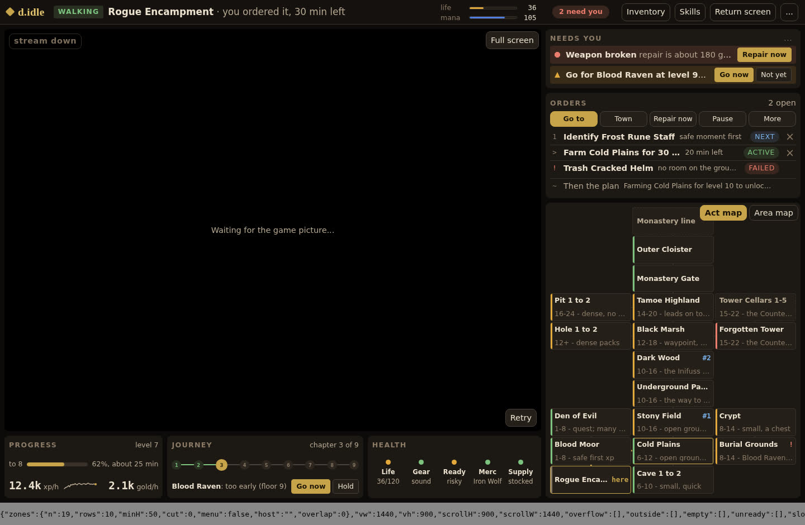
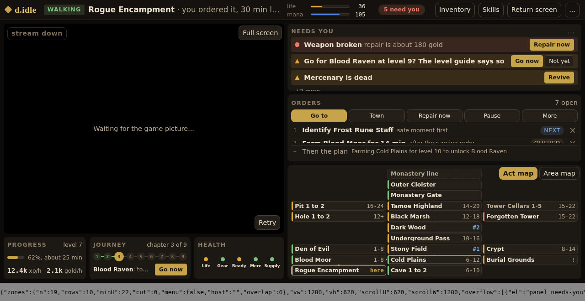
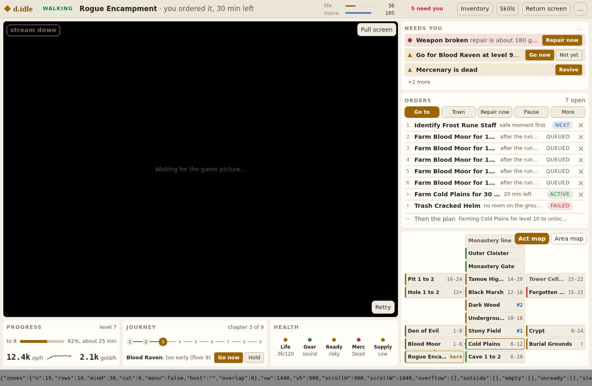
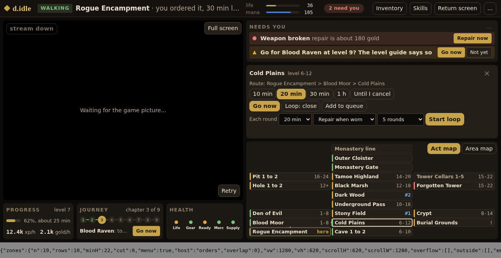
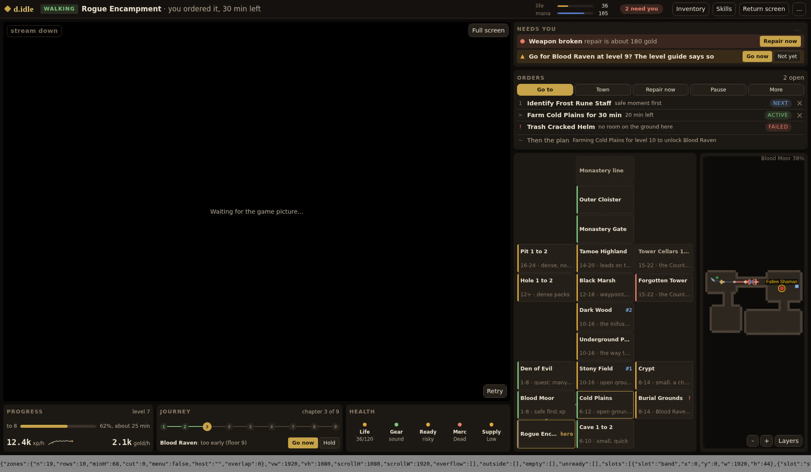
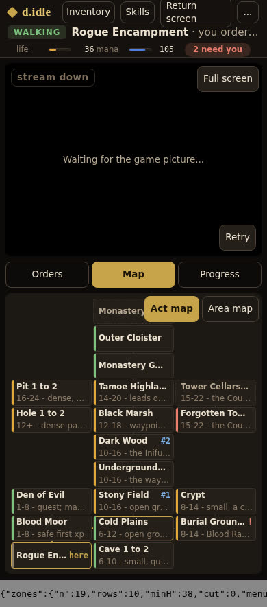

# Review of the merged watch cockpit (S1b to S6, B1, B4 to B6), before S7 makes it the default

> status: review, 2026-11-15, of `origin/main` at `0caf89220` (`?layout=cockpit`). Reviewer: the design reviewer of the redesign (TASK-480). Not verified live: every picture is the frozen fixture viewer on the builder, nothing ran on the worker host or the sandbox. Tags: V = seen in a render named here or read in the code at the line given, U = not checked.

## Verdict: APPROVE WITH CHANGES

The cockpit as merged holds the user's frame: at all seven desktop sizes the page does not scroll, the band, the picture, the strip and the rail tile the window, and the picture, the sentence, Needs you, Orders, the act map, Progress, Journey and Health are on screen together (V, renders 01, 04, 05). It is close to the accepted renders. It may stay on `main` behind `?layout=cockpit`.

**S7 must not flip the default until the 13 required changes below (R1 to R13) are in.** Four of them are things the user would see in the first minute: a pause that the band never reports (R1), order rows that cannot be told apart at 1440x900 (R6), Health that is colour only on a short window (R4), and a "+2 more" line cut in half at 1280x620 (R3).

## How this was checked

- Renders: 113 pictures through the fit harness (`/__fit`, an iframe of exactly the size) on the builder, headless Chromium, 161 s, one `labrun` job. Sizes 1920x1080, 1440x900, 1366x768, 1914x930, 1904x1000, 1536x730, 1280x620, 390x844. States: needs 0, 2, 5; orders empty, one (paused), three, eight, a Loop row; a blocked journey; paused; mercenary dead with supplies low; no mercenary with no potions; the zone menu (in range, too hard, with the Loop form); the "..." menu; the sentence popover; both drawers; the three phone tabs; dark and light. About 25 were opened and read one by one (every state at least once, the tight sizes 1280x620, 1366x768, 1440x900 and the phone most), the rest only produced.
- The fixture has no variant for a dead mercenary, low supplies, a paused sentence or a Loop row. They were added to a local, uncommitted copy of `tools/uishots/fixtures_glance.go` and `fixtures_commands.go` for this run and reverted. S7 needs them in the tree (S7 checklist, item 1).
- The game picture is "stream down" in every render (the fixture frame does not load inside the harness iframe), so the picture tile, its zone label and the letterbox were not judged.
- Code read: the nine cockpit panels, `shell.js` (layout choice, cockpit frame, drawers, toast, focus keeping), `glance.go`, `commands_post.go`, `cmd/d2bot/glancewire.go`, `whyline.json`, `whychange.json`.
- Contrast: computed from `tokens.css` (WCAG relative luminance), not measured on pixels.

## Renders

| | |
|---|---|
|  | 01: the default at 1440x900, two needs, three orders. Fits. Titles cut in Orders, the map switch sits on "Monastery line", no legend |
|  | 02: five needs and eight orders at 1280x620. "+2 more" is cut by the tile edge, the order list shows one row and a half, Health has no words |
|  | 03: light theme, five needs, eight orders, mercenary dead, supplies low. Five order rows read the same |
|  | 04: the zone menu with the Loop form at 1280x620. No zone button covered; the menu covers the Orders tile and its verbs |
|  | 05: 1920x1080, mercenary dead, supplies low. The area drawing uses about a third of its tile |
|  | 06: the phone's Map tab. The switch covers a zone button, "Return screen" wraps out of the band, the reason is cut |

## Required changes, by slice owner

### B1 and S2 (pause, the sentence, `/api/glance`)

**R1. A player pause never reaches the band.** `glance.go:279` reads `GlanceSources.Paused`, but nothing binds it: `cmd/d2bot/glancewire.go:38-41` sets only `Merc` and `Supplies`, `cmd/d2bot/pausewire.go` has no glance line, and the only `Paused` hook in the tree is the Orders one (`internal/watch/commands.go:629`) (V, grep of every non-test Go file). So after Pause the Orders verb turns to Resume while the band keeps its last word and reason. Bind it in `pausewire.go` through `glanceExtra`, for both states of `watch.pause/1`: `going_home` and `paused`. Add a Go test that a paused desk gives `sentence.word == "Paused"`.

**R2. The `player_pause` Why code has no text** (B1 left it in `docs/pause.md:18`). Its proposal is too long for the band at 1440 px and below (V: a 54-character reason was cut in the paused render). Proposed, to be added by the owner of the two JSON files:

| File | Text |
|---|---|
| `whyline.json` `player_pause`, params `["step"]` | "Paused by you: {step}." and "You paused me: {step}." |
| values of `{step}` | "going home first" (state `going_home`), "waiting in town" (state `paused`) |
| `whychange.json` `player_pause` | "Resume and I go back to the plan; orders you give now wait until then." |
| band reason (`GlanceSources.Paused` text) | "paused by you, going home first" and "paused by you, Resume continues" (31 characters at most, fits 1280 px) |

**R3 is under S3.**

**R7. The sentence is redrawn on every poll.** `panels/statusline/panel.js:50-65` clears and rebuilds the line and the popover each time `update` runs (`:69-75`), every two seconds, with no check that anything changed. The line is `aria-live="polite"` (`:31`), so a screen reader may be told the same sentence again and again, and an open popover loses the focus on "Open the log" (the link has no `data-key`, so the shell's `keepFocus` cannot restore it). Keep the last reply's signature and return when it is the same, as `needs-you/panel.js:114-116` does.

**R8. "Next: Next: Farm Stony Field for 20 min."** in the popover (V, the sentence render): `hero.go:251` already starts the text with "Next: " for the old Why tile, and `statusline/panel.js:18` adds the label "Next". Strip the prefix in the panel (the old tile keeps its text).

### S3 (Needs you, Progress, Journey, Health)

**R3. Needs you overflows at 1280x620 with four or more needs when Orders is long** (V, render 02; the harness line under the picture reports `overflow: panel needs-you`). Three rows plus the "+N more" line plus Orders' own minimum do not fit above ten 22 px zone rows in 620 px. The fit suite misses it: it has `strip-needs5` and `orders-eight` but not both at once. Fix: the "+N more" link moves into the header line (in place of the "..." at the right, which opens the same popover), and on a short window (`COCKPIT_SHORT`) the panel shows two rows. Add the fit case `needs=5&cmd=eight`.

**R4. Health is colour only on short windows.** Under 230 px of cell width `panels/health/panel.css:22` drops the word of every light and sets the name in 9 px (V, renders 02 and 04: five dots with "Life Gear Ready Merc Supply"). That is the cell at 1280x620 and 1536x730. A red dot under "Merc" does not say dead, and the survival word ("risky") is then nowhere on the default screen. Fix: no text under 10 px; when a light is not ok show its word in place of its name ("Dead", "Low", "risky"), in the state colour, and keep the name in the `title`. An all-green row may keep names only.

**R5. Hold is unreachable at three desktop sizes.** `panels/journey-strip/panel.css:29` hides every button but the first when the cell is under 270 px: at 1366x768, 1536x730 and 1280x620 only "Go now" is left (V, renders 02, 04 and the 1366 renders), and the popover lists chapters without the actions (`panel.js:89` draws them in the strip only). Put both actions in the popover, or keep Hold as a short second button.

### S4 and S5 (Orders, the act map, `/api/commands`)

**R6. Order titles are cut before their reasons.** `panels/orders/panel.css:15` gives the title `minmax(0, auto)` and the reason `minmax(6rem, 1fr)`, so the title gives way first. At 1440x900, where the rail is the narrowest of all desktop sizes (456 px), eight orders read "Farm Blood Moor for 1..." five times with "after the run..." beside each (V, render 03), and the running order reads "Farm Cold Plains for 30 ..." (V, render 01). The minutes are the part that differs. Fix: the reason shrinks to nothing before the title loses a character; on the phone the reason goes to the `title` only.

**R9. "Go now" cancels every open order and Undo does not bring them back.** `commands_post.go:107` sends `replace: true`, `hub.go:517` cancels the open orders first, and `undoFor` (`commands_post.go:165-173`) cancels only the new one (V, code). The toast says "Order given: ..." with an Undo that leaves the hero with no orders at all. Either the Undo restores what was replaced, or the menu and the toast say it: "Go now (replaces 2 orders)" and "Order given; 2 earlier orders cancelled". The second is the smaller change and is enough.

**R10. The zone menu cannot be used from the keyboard in reading order.** The sheet is `role="dialog"` without a name (`panels/zone-map/panel.js:114`), `open()` (`:121-128`) does not move the focus into it and `close()` (`:116-120`) does not return it. With a one-column rail the sheet is inside the Orders tile, which is before the map in tab order: after g, the arrows and Enter, the user must Shift+Tab backwards to reach "Go now". Fix: `aria-label` "Order for <zone>", focus the primary button on open, return the focus to the zone button on close and on Esc.

**R11. The map has lost its legend and its heading.** The accepted render has "Where to, click a zone to send the hero" and four legend lines (in your range, above it, too hard now, not open yet) in the empty cells at the top left. The merged map has neither (V, render 01 against `research/iterations/final/watch-1440x900.png`): the stripe colours are unexplained and carry their meaning by colour alone. Put the legend back into the empty top-left cells (they are empty at every size from 1366x768; on short windows a `title` on the switch is enough).

### S6 and S1b (the shell: map switch, phone band)

**R12. The map switch covers a zone button** at 1440x900 and on the phone (V, renders 01 and 06: "Act map" lies on "Monastery line"). `shell.css:175` pins it to the tile's top right corner, and at a 456 px rail the two buttons are wider than the empty third column. Fix: shorter labels as one segmented control ("Act", "Area"), which fits the empty cell at every size, or a reserved strip when it does not. Add the switch to the fit check's overlap rule (it tests the zone menu only).

**R13. The phone band is broken in two places** (V, render 06). "Return screen" wraps onto two lines and is cut by the 36 px row (`shell.css:118-124`): use one word ("Return") or move it into "...". And the reason, the part that says why, is cut after about eight characters ("you order..."): give the sentence the second band line to itself with the meters on the first, or let it wrap to two lines.

## Should fix (not blocking the flip, but before anyone calls it finished)

- **Contrast of `--d-text-3`.** Dark: 4.32:1 on surface 1, 4.00 on surface 2, 3.62 on surface 3. Light: 3.82, 3.30 and 3.12. It is the colour of every tile heading, the row index, the cancel crosses, the "not reported" words and the numbers in the to-come chapter dots (9.5 px). Light theme state chips: ok and warn on their tinted ground are 4.17:1. S7 owns the CSS: in the cockpit use `--d-text-2` for text and keep `--d-text-3` for marks, which need 3:1.
- **Buttons outside the dispatcher.** The buttons of Needs you (`needs-you/panel.js:50-56`) and Journey (`journey-strip/panel.js:42-48`) post by themselves: no toast on success, no Undo, no refresh, so "Repair now" shows nothing until the next poll. Where an intent exists (repair, revive_merc, journey) send them through `sendCommand`. The row cancel (`orders/panel.js:171-177`) has the same silence.
- **Journey and Health redraw on every poll** without a signature check (`journey-strip/panel.js:70-81`, `health/panel.js:46-63`): a focused chapter dot loses the focus every two seconds (the dots have no `data-key`), and an open popover is rebuilt under the reader. The nine dots are nine tab stops that all open one popover: make the path one button.
- **Phone rows.** Order rows are 28 px with a 22 px cross (`orders/panel.css:30`) although the phone sets `--c-touch: 38px` (`shell.css:196`); titles are cut at about 14 characters and "Repair now" is cut to "Repair ..." (V, render 06 and the Orders tab renders). Health's detail lines on the Progress tab end in an ellipsis with free room below: let them wrap.
- **Missing second lines.** `whychange.json` has no entry for `journey_blocked`, `farm_user`, `repair_wait`, `repair_trip` and `repair_farm`, so the popover has no "Would change it" exactly where the player asks. Proposed: `journey_blocked` "A level up or better gear opens the path; Go now in Journey makes me try at once."; `farm_user` "Reaching the amount, or your cancel in Orders, ends it."; `repair_wait` "The next safe moment starts the trip; cancel it in Orders."; `repair_trip` "Once the gear is repaired I go back to what I did."; `repair_farm` "Enough gold starts the repair; cancel it in Orders."
- **The blocked row drops its actions.** `orders/panel.js:239-245` ignores `CommandBlocked.Actions`; the row says the journey is blocked and offers nothing. Draw them or take the field out of the view.
- **A too-hard zone** offers "Ask anyway" as the gold primary button with Loop and Add to queue beside it, and its reason says "clvl" ("no mercenary and clvl 6 is below 16", `mapview.go:226` and the guard text). Say "level", and make "Ask anyway" a plain button.
- **A Loop row looks like any order** (">" and ACTIVE). Give it its own mark and the round in the chip ("round 2 of 5").
- **The verb row lost its key hints** (the accepted render shows g, t, r, p). The keys work (`orders/panel.js:159-163`) but nothing on screen says so: put the key in the `title` at least.
- **Popover label "Danger here: safe"** reads wrong. "Risk here".

## Wording of the sentence, per Why code

The band shows the state word, the place and then the reason. The reason is "you ordered it, N min left" while an order runs, else the first `say` variant of the Why code. Judged for the band (about 45 characters at 1280 px, 70 at 1440 px) and for the popover.

| Code | Verdict |
|---|---|
| `fight` | Weak in the band: "Fighting · Blood Moor · Fighting in Blood Moor, my life is 72%" says the word and the place twice. Needs a short form |
| `walk` | Same repetition ("Walking · Cold Plains · Heading to Cold Plains because..."), and too long: cut at "because the plan" |
| `quest_step`, `town_trip`, `town_chores`, `claim_trip`, `back_to_field`, `area_done`, `guard_exit`, `farm_runs`, `after_death_*`, `hold`, `player_items` | Good: short, say the cause |
| `heal_trip`, `wait_heal` | Good, but `heal_trip` is 78 characters: cut at every size under 1920. It also prints the retreat line as a percent; that is the hero's own setting and life, not the survival margin, so it does not break the words-only rule (U: confirm with the user that life percentages are fine in the sentence) |
| `to_town` | Weak: "there is nothing for me to do outside right now" does not say why. Name the cause when it is known |
| `farm_gold` | Wrong word: "levelling up from level {level} until I can afford" mixes two goals. "Short of gold: farming until I can afford what I need." |
| `farm_user`, `repair_farm`, `saving_for` | Good, long (70 to 80 characters): the amounts are cut first at 1440 px. Put the amounts first |
| `repair_wait`, `repair_trip` | Good |
| `journey_blocked` | Too long (about 100 characters with the reason): only "The quest path is blocked (" survives at 1366 px. "Quest path blocked: {why}. Farming meanwhile." |
| `activity` | "Now: {activity}." repeats the state word; drop "Now: " in the band |
| `player_pause` | Missing; text in R2 |
| order running | "you ordered it, 12 min left" is right and short, but with the word "Walking" and the place of the moment it does not say where to. "to Cold Plains, your order, 12 min left" while the hero is not there yet |

Proposal for S2's owner: a third, optional field `band` per code in `whyline.json` (the short form without the place), used by `glanceSentence` when present. It is additive.

Survival margin: words only everywhere I looked (V: `marginWord` in `glance.go`, the "Danger here" row, the Ready light; `glanceSurvival` drops a block whose margin is not one of the three words; no panel reads the raw `survival` object).

## Orders, point by point

| Asked | Finding |
|---|---|
| Two clicks to an order | Yes: a zone, then "Go now" (the last duration is remembered). V, render 04 |
| Undo toast | Present, five seconds, key z. It does not undo what "Go now" replaced (R9). It does not wait while the pointer is on it (nit) |
| Menu never covers a zone button | True for the zone menu at all eight sizes (V, the harness reports `overlap: 0`). Not true for the map switch (R12). The menu covers the Orders tile and so Pause while it is open: by design in J, Esc closes it |
| Queue and Loop states | Queued rows carry a place number and QUEUED, the next one NEXT, a failure "!" and FAILED. The Loop row is not marked as a loop (should fix). A full queue disables "Add to queue" with its reason beside it (V, code `zone-map/panel.js:221-223`; not rendered) |
| Keyboard path | g, t, r, p, o, z, / and Esc work (V, code). The zone grid has arrow keys and one tab stop. The menu is the gap (R10) |
| Refusals visible | A refused command shows the dispatcher's words in a toast or in the menu line; a disabled verb shows its reason under the row (V, code `orders/panel.js:226-231`; U live) |
| One dispatcher, shared with Loop | Yes: `sendCommand` in the Orders panel is the only client of `POST /api/commands`, the zone map imports it, and `loop` is one of its intents (V, `zone-map/panel.js:151`, `commands_post.go:117-130`). Needs you and Journey are outside it (should fix) |

## Fit, dead space, density

- Frame: no scroll and no slot overflow at the seven desktop sizes in every state except R3 (V).
- 1440x900 is the tightest desktop, not 1366x768: its picture is taller, so its rail is 456 px against 558 px. Zone names ("Tamoe Hig...", "Forgotten ...", "Undergrou...") and order titles are cut there first. S7 should judge that size before any other.
- Inside the tiles at 1904x1000 and 1920x1080: with no needs the zone buttons are 68 to 76 px tall around two lines of text that are still cut for width, and the area drawing fills about a third of its tile (V, render 05). The fit check counts tiles, not ink, so it passes. By the user's meaning of dead space this is the weakest part of the large sizes. Proposal for the user's eye, not a required change: on a two-column rail the area tile takes its drawing's shape at the top and the last lines of the Log's "Now" tab fill the rest.
- Empty Orders ("No orders. The hero follows the plan.") is right: one line, and the map takes the room.

## Phone

Three tabs under the picture, in the thumb's reach, arrow keys between them, no sideways scroll in any render. Broken: R12, R13 and the row sizes under "Should fix". The zone menu fills the Map tab and hides the map while open: acceptable.

## Accessibility summary

| Point | State |
|---|---|
| Roles and names | Tabs, drawers, popovers, switch and meters are named. The zone menu is not (R10) |
| Tab order | Band, picture, strip, rail in reading order (V, DOM order in `applyCockpit`). Nine chapter dots are nine stops (should fix) |
| Focus rings | 2 px ring on the sentence, the needs buttons, chapter dots, zone buttons, health and progress (V, CSS). Kept across polls only for controls with a `data-key` |
| Contrast | Body text passes in both themes; `--d-text-3` fails in both (should fix) |
| Colour alone | Health on short windows (R4), map stripes (R11) |
| Live regions | The sentence is announced on every poll (R7); toasts are `role="status"` |
| Reduced motion | The duration tokens are zero under `prefers-reduced-motion` (`tokens.css:108`); the cockpit panels have no animation of their own (V, grep) |

## S7 readiness: what must be true before the default flips

1. R1 to R13 merged, and the fit suite extended with the states it lacks: `needs=5&cmd=eight`, a paused sentence, a Loop row, mercenary dead and supplies low, the light theme at all eight sizes (today one light case), the map switch in the overlap rule. The fixture variants for these do not exist in the tree.
2. The default is chosen in `shell.js:399-423`, not only by `web/layout.json`. The S7 brief does not own `shell.js`; it must. Today the code falls to `standard`, and for a new hero to `simple`.
3. A stored layout is untouched (`srv.source !== 'default'`), with a test. A preset the user picked in the menu is kept. But `shell.js:421` pins `simple` by itself for every new hero: that is not a choice, and those users would never see the cockpit. Decide and test: treat an auto-pinned Simple as "no choice".
4. The Layout menu lists the cockpit and marks the current layout. Today it lists Classic, Simple, Standard, Stream and Debug only (`layout.js:149`, `shell.js:751`; V, the menu render): after one click on Classic the only way back is the URL.
5. The one-time line "The layout changed. The old ones are in the menu." shows in the cockpit. Today `shell.js:877` skips the note there.
6. First run: the first-steps card is only a chip inside "..." (V, the menu render, "Getting started 0 of 5"). A new hero must meet it without opening a menu: open the drawer once, or a Needs you row with "Open". Check that its buttons work in a cockpit ("Show the Journey" pointed at the old Journey tile; U).
7. Everything that had a place on the old page and has no slot is reachable, each with a test or a render: the hold question sheet, the unlock reveal sheet, the update banner, the message bar (`role="alert"`), the policy sheet, the pact page. None was rendered here (U).
8. `?mode=overlay` and the Stream layout render the same as before the flip (`shell.js:858` keeps the cockpit out of overlay mode; prove it with the existing overlay golden).
9. The Electron viewer opens `/watch` (`apps/desktop-electron/src/address.js:5`) and so gets the new default. Render its default window size and say what a window between 700 and 1279 px wide shows; no size in that range was rendered by anyone (U).
10. A browser that has the old `shell.js` cached and gets the new `layout.json` shows the fallback placements, which hold the picture only. Make sure the two are fetched as one version (U).
11. Edit layout opens from the cockpit menu (present, V) and a saved cockpit edit comes back as the cockpit.
12. Both themes at the eight sizes read by a person, 1440x900 first; a keyboard walk from the band to "Start loop" and back.

## Nits

- Band: "Inventory" where the accepted render says "Character".
- "2 need you" and "1 needs you" are right; "all quiet" is good.
- The paused render still shows the running order as ACTIVE with time left; say "held" while paused.
- A blocked journey still offers "Go now" as the gold button.
- The `title` of a cut row is the only way to read it; a touch device has none.
- Needs you hides itself when `/api/glance` fails (`needs-you/panel.js:111`), so a red row vanishes with the connection; the band says "No signal", which is enough only if the user looks there.
- The same `data-key` is used for a need's button in the list and in the popover.
- The toast with Undo does not pause on hover or focus (`shell.js:85-98`).
- Numbers on the first screen: far above the brief's target of about 16 once the sixteen zone ranges count. Either the target excludes the map or the ranges go to the menu on short windows.

## To verify live on the sandbox (nobody has)

1. Pause from the Orders row while fighting: the band says Paused through going home and in town (after R1); Resume brings the plan back.
2. "Go now" with two orders open: what the list shows, what Undo leaves (R9).
3. A real mercenary death and an empty belt: the Merc and Supply lights, the matching Needs you row and its Revive button.
4. A real blocked journey (B6): the Orders row, the Journey line, the sentence.
5. The picture tile with a live stream at 1440x900 and 1280x620: the letterbox, the zone label, Full screen and back without a layout jump.
6. Until-level orders (B4): the row text and its time left.
7. A refused order (too hard, not in town) and a locked Loop or queue: the words the player sees.
8. The phone on a real device: thumb reach of the tabs, the cross on an order row, the popovers.
9. Two minutes with a screen reader on the band (R7).
