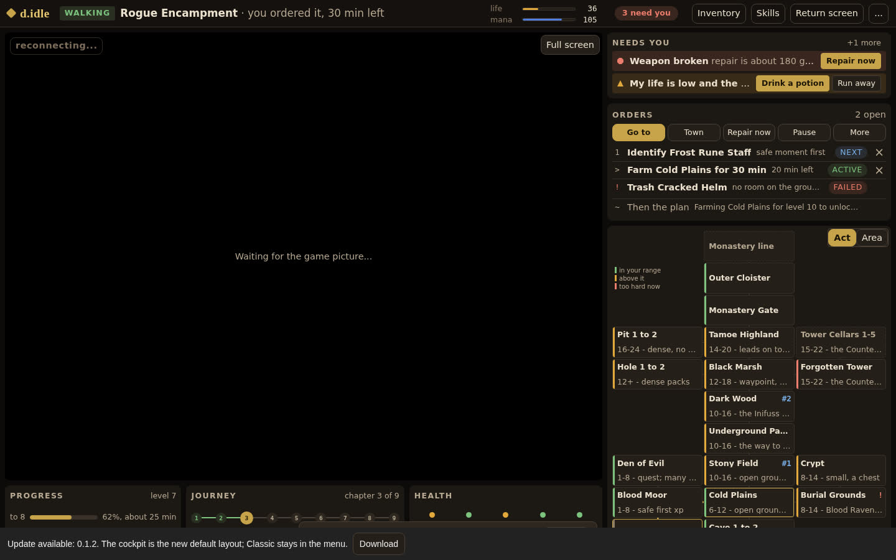
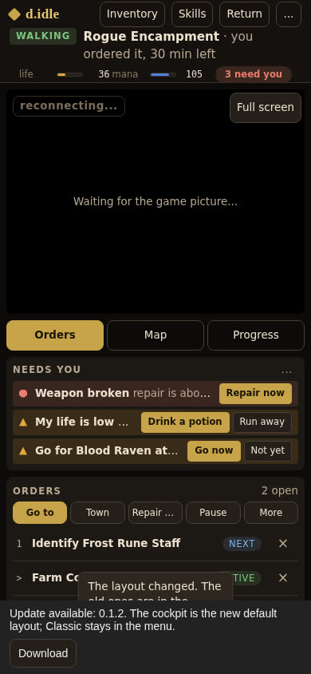
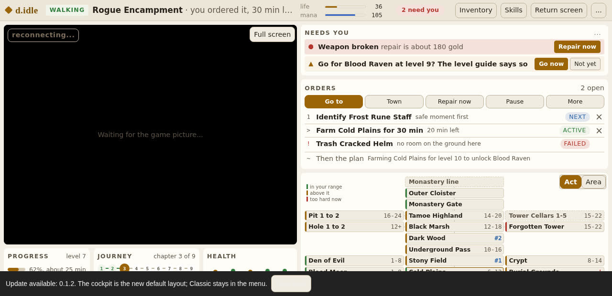
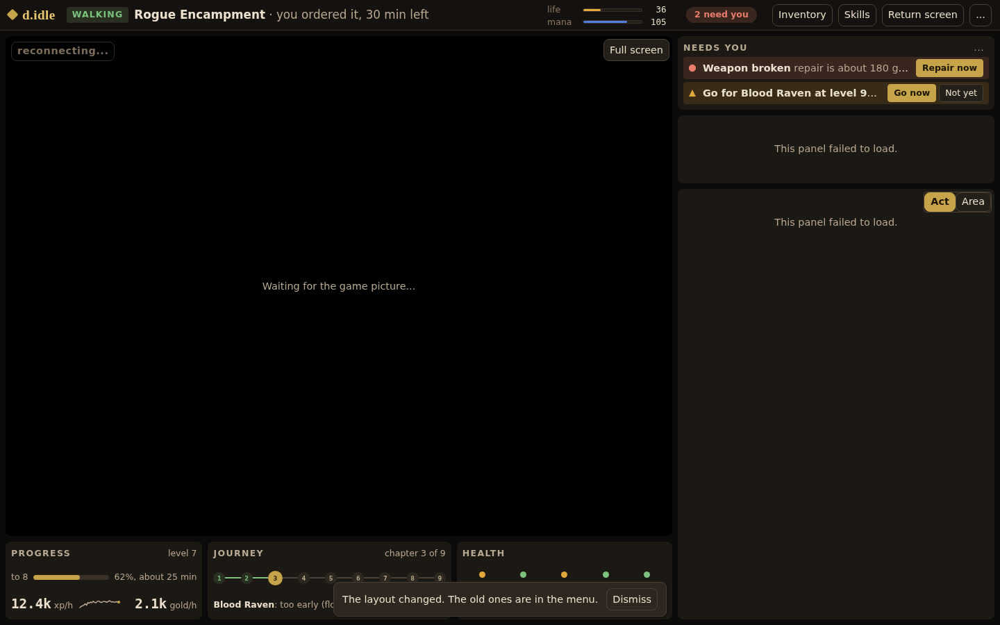

# Review of S7 (the cockpit becomes the default), before it merges

> status: review of branch `agent/uis7` at `be9ac3373` (2026-11-15), done before the merge. Nothing here was checked on a live game or on the sandbox. Tags: V = verified (how is said), S = secondary (read in a doc), U = unverified.

## Verdict: APPROVE WITH CHANGES

The flip itself is sound: every stored layout and every menu choice I simulated keeps its layout, the overlay strip is unchanged, the frame fits at every size I rendered, and the menu has a way back. Six things must change before the user or a friend sees it (R1 to R6). Two of them are certain to be seen: the update banner lies over the bottom of the fixed frame and cannot be dismissed (R1), and a hero question is cut to five words with only two of its answers (R3).

The riskiest gap: nobody has seen the default page with real data. Every render is the frozen fixture; the live picture, a real question that fades, a real update banner and a touch phone are all unseen (section "Live checks").

## What was done

- Code read: `git diff origin/main...agent/uis7` (23 files). `origin/main` has one commit the branch lacks and merges clean (V, `git merge-tree`). `agent/uic4` has not landed; it conflicts with this branch in `tools/uishots/fit.js` (V, `git merge-tree agent/uic4 agent/uis7`), so whichever merges second resolves that file.
- A copy of the branch head got review-only fixtures (`reviews/s7/review-fixtures.patch`: cookies pick an update banner, a face-down reveal card, question rows, a stored layout, an old hero, a missing manifest, a panel script that fails to load; a page that sets localStorage before the watch page opens). Nothing was changed on `agent/uis7`.
- On the builder (`labrun <builder> -- tools/review-shots.sh ...`, headless Chromium, never the worker host that runs the games): 28 DOM dumps for the layout states and 148 pictures: the default page at the eight fit sizes plus 1024x768, dark and light, default, empty and full; the live picture at the same sizes in both themes; the update banner (available and ready), the reveal sheet, one and three question rows and the layout note at five sizes; the Electron minimum 900x600. Every picture was looked at (about 20 at full size, the rest four to a sheet) and compared with `research/iterations/it3/watch-1440x900.jpg`.
- Contrast was measured on the rendered pixels (text colour against its ground), not from the token table.
- Not done: the author's `--fit` suite was not rerun (U; the card says it passes); no keyboard walk in a real browser (code read only); no screen reader; no render with a coarse pointer.

## Required changes

**R1. The update banner covers the frame and cannot be put away.** `web/update.js:11` fixes the banner to the bottom of the window; the cockpit frame is the whole window (`shell.css:128`, `--c-fh: 100dvh - band - gaps`). In the "Update available" state the banner has one button, Download, and no Dismiss (`update.js:47-48`). So from the day an update exists every friend's default page has its bottom 44 to 90 px covered until they download: the Journey buttons, the Health words and the last map row at 1440x900; nearly the whole strip at 1280x620; the last order rows on the phone (V, renders `x1-update-*`, `reviews/s7/01-...jpg`). The old page scrolled, so this is new with the flip. Also in the light theme the banner's button is an empty light box, the label cannot be read (V, `reviews/s7/03-...jpg`; `update.js:23` sets only padding). Fix: the shell reserves the banner's height (observe `.update-banner`, set a length on the shell and subtract it in `shell.css:128` and in the phone frame), give the button a colour and ground of its own, and add "Later" to the available state. `update.js` is outside the S7 owns: add it.

**R2. The one-time line is silent for the people most likely to look.** `shell.js:376` reuses the key `d2layoutnote` that the Standard flip of 2026-11-14 already used, and `shell.js:816` skips the note when it is set. A browser that dismissed "The layout changed. Classic is in the menu." gets the cockpit with no line at all (V, DOM dumps `s03`, `s05`: cockpit, no note). Use a new key (`d2layoutnote2`). The same holds for the Simple case below: with the old key set, an unpinned Simple turns into the cockpit without a word.

**R3. A hero question is not answerable as it was.** (a) `glance_questions.go:31-33` keeps the first two choices. Six of the 26 points in `internal/decide/catalogue.json` have three or more real answers (`t0.retreat.drink` has five; `t1.quest.imbue` loses "jewelry"; V, counted): in the cockpit those answers do not exist. (b) The row is one line: at 1440x900, 1024x768 and on the phone the question reads "My life is low and the ..." or "My life is low ..." (V, renders `x3-question*`, `reviews/s7/01-...jpg`); the full text is only in `title`, which touch has not. (c) Nothing says the question fades or when; the old Thoughts card did. (d) With one red row and a short window (two rows shown) a second and third question sit behind "+N more" while they fade (V, `x3-question3-1440x900`). Fix: carry every choice in `Actions` and the seconds left in `Sub`; in `panels/needs-you/panel.js:55` a question row shows its text on two lines (or opens the popover on click) and the popover lists the full text, all choices and the time left; a new question is announced once like a new red row. Add the confirm route to `glance_questions_test.go` (only `/api/answer` is tested).

**R4. A slot panel that fails at run time leaves a dead rail and no way back in sight.** The self-check (`shell.js:855-862`) reads the manifest list only. When a panel script fails to load or throws in `mount` (`shell.js:914-918`), the box says "This panel failed to load." and that is all; because the zone map imports the Orders module, a failed Orders script takes both (V, `reviews/s7/04-...jpg`: no orders, no map). The menu still has Classic, but nothing says so. Fix: when a slot panel of the default cockpit fails, show one message with a button ("Part of this layout did not load. Use Classic"), or fall back to Standard as the self-check does. And when the self-check does fall back, the line it shows today is the wrong one ("The layout changed. Classic is in the menu.", V, `s16`): say that the new layout could not load.

**R5. Phone buttons under the slice's own floor.** Measured in the 390x844 render: the Needs you buttons (Repair now, Go now) are 26 px tall, the Orders verb row 28 px (`panels/orders/panel.css:9`), the band buttons 32 px; the tabs and the order cross are 38 px. The brief asked for 38 to 44 px; this review's bar was 44. Bring the Needs you buttons and the verb row to `--c-touch` on the phone at least, and say in the card that 44 px is not met.

**R6. Say it in the release.** The card's `result:` (it becomes the changelog line) must say: the default watch layout changed; a saved layout or a menu choice is kept; the way back is "..." then "Layout: Classic", or the address `/watch?layout=classic`. Without it a friend who updates meets a new screen with a note that R2 may hide.

## Compatibility (check 1)

Simulated in the browser against the branch (V, DOM dumps: template, the ticked menu entry, the note). "Old hero" means the welcome card is gone.

| Browser and server state | Before S7 | After S7 | Verdict |
|---|---|---|---|
| nothing stored, old hero | Standard, note | cockpit, note | intended |
| nothing stored, old hero, `d2layoutnote=1` | Standard | cockpit, no note | R2 |
| nothing stored, new hero | Simple, pinned | cockpit, first-steps drawer once | intended |
| `d2layout=simple`, no marker | Simple | cockpit, note | the rule below |
| `d2layout=simple`, no marker, `d2layoutnote=1` | Simple | cockpit, no note | R2 |
| `d2layout=simple`, `d2layoutpick=1` | n/a | Simple | kept |
| `d2layout=classic`, `standard`, `stream`, `debug`, no marker | that preset | that preset | kept |
| stored layout on the server, no choice | stored | stored | kept |
| stored layout, `d2layout=saved` | stored | stored | kept |
| stored layout, `d2layout=simple`, no marker | Simple | stored | changed, toward the hero's own layout; acceptable |
| `d2layout=saved`, no stored copy, base `standard` | Standard | Standard | kept |
| `d2layout=saved`, no stored copy, no base | Standard | cockpit, note | acceptable |
| `?layout=classic`, `simple`, `standard`, `stream`, `debug`, `none` | that | that | kept |
| `?mode=overlay` | Standard strip | Standard strip | kept (V, picture) |
| `?mode=overlay`, `d2layout=cockpit` picked in the same browser | n/a | the same strip | fine (V, picture) |
| `?layout=overlay` | Standard | cockpit | not a layout name; no doc uses it (V, grep) |
| manifest lacks a slot panel | n/a | Standard, wrong note | R4 |

**The auto-pinned Simple rule.** Keep it. The old shell wrote `d2layout=simple` in two cases it could not tell apart: by itself for a new hero, and on a click on "Layout: Simple". S7 treats both as no choice. The exact failure: someone clicked "Layout: Simple" on a build made between the commit that added the menu (`725c1ed61`, 2026-11-14) and S7, and after the update their page opens as the cockpit. Who can that be: the Layout menu does not exist in the 0.1.1 record commit (V, `git log -S`; U for the pack itself, I did not open it); it is in the staged 0.1.2 (V, ancestry of `d410372d9`), which is not published (S, `docs/releases/0.1.2.md`). So today it is the project's own browsers only. One click on "Layout: Simple" brings it back and sets the marker. The opposite rule would leave every hero who started on that one-day build on Simple for good, which is the larger harm. Two conditions: R2, so the line always shows; and do not publish the staged 0.1.2 as it is and S7 after it, or friends get two default changes in two updates and the failure case becomes real for them (a decision for the coordinator: rebuild 0.1.2 after S7).

**Other consumers.** The Electron viewer opens `/watch` and gets the cockpit; its minimum window 900x600 holds without scroll (V, render), but the status sentence is cut to "Ro..." there and at 1024 px to the place name without the reason (should fix). Static files are served `no-store` from one embedded tree (V, `http_view.go:60`), so an old `shell.js` with the new `layout.json` can only come from a tab that was open across the update; a reload cures it. Edit layout "Reset" now returns to the cockpit for a layout saved before `d2layoutbase` existed; that is what Reset means.

## The self-check (check 2)

It guards a case that the embedded file tree makes nearly impossible (the manifest list and the layout come from the same binary; `TestDefaultCockpitSlotsHavePanels` catches it at build time). The cases that can happen (a script fails to load, `mount` throws in an older browser or Electron) are not guarded: R4. `shell.js:877` returns silently when `/watch/panels.json` fails, which leaves an empty page in every layout (old behaviour, nit).

## What the renders show (check 3)

Good: no scroll and no clipped tile at any of the nine sizes in either theme, in the default, empty and full states (V, by eye; the fit suite is the author's). The live picture fills its tile at the eight fit sizes; empty Needs you gives its room to the map; the first-steps drawer opens once with the focus on Close; the reveal sheet opens over the frame with the focus on "Flip the card" and is usable on the phone; the layout note floats and can be dismissed.

Problems beyond R1 to R5:
- The note sits on the Journey buttons and the Health words until dismissed, and the update banner covers the note; on the phone the banner covers the note's Dismiss (V, `reviews/s7/02-...jpg`). Put the note under the band, next to the "..." it talks about.
- Short windows (1536x730, 1280x620, 1024x768, 900x600): Health reads "36/120 Gear risky Merc Sup...": some lights show their name, some their value, two are cut. One rule: the name, and the value only where it is not fine.
- 1024x768: the 4:3 picture is letterboxed with about 70 px of black above and below (V). It is dead space by the user's meaning, at a size outside the four he named.
- 1920x1080, 1904x1000, 1914x930: the area map tile is about a quarter drawing and three quarters empty (V; already in the cockpit review). The user rejected the first attempt for dead space: show him this size first.
- Phone, no orders: the Orders tab is empty below "Then the plan" (about 190 px).
- Differences from the accepted render: "Inventory" for "Character"; a "Return screen" button in the band; no key hints on the verb row; no "WHERE TO" heading and no act selector I to V; no zone label on the picture; the legend is three lines without "not open yet".

## Accessibility (check 4)

| Point | State |
|---|---|
| Contrast, dark | passes everywhere measured (lowest: the band's life and mana labels, 4.61:1) |
| Contrast, light | fails: "Waiting for the game picture..." on the black tile 2.87:1 (`.d-empty` takes the light theme's text colour, `components.css:130`); the band's life and mana labels 3.12:1 (`panels/hero-meters/panel.css:10`); "here" 4.24:1 (`panels/zone-map/panel.css:27`, use `--d-accent-text`); the "reconnecting..." badge 4.27:1. The chips S7 fixed pass (4.58 to 4.89:1) |
| Focus ring | 2 px on every control of the cockpit, the drawers and the note (V, CSS `components.css:249-251`; seen on Close and on "Flip the card") |
| Keyboard path | band, picture, strip, rail in DOM order; the note and the message bar are appended to `body`, so they come last and the note is not announced (`role="note"`). Esc closes drawers and the menu (V, code). U in a browser |
| Roles and names | dialogs, tabs, the switch, the meters and the zone buttons are named (V, code). The reveal sheet says `aria-modal` with no scrim and no focus trap (old) |
| Live regions | the sentence is `aria-live`; a new red need is a toast; a new question is not announced (R3) |
| Reduced motion | duration tokens are zero; the cockpit panels have no animation of their own (V, grep) |
| Tap sizes | R5; the menu, drawer and note buttons are 44 px under a coarse pointer (V, CSS only) |

## Code and tests (check 5)

- `effectiveChoice` and `missingSlots` are small and tested. The order of precedence itself (address, choice, stored, default) still lives in `loadLayout` in `shell.js` and is tested only by string matches in `layout_test.go:253`. Move the decision into one pure function in `layout.js` and test the table above (should fix; my DOM dumps did it once by hand).
- `tools/uishots/fit.js`: a drawer is now outside the fit rule altogether, so a drawer whose content is cut sideways passes. Keep the horizontal test for drawers (nit). Conflict with `agent/uic4` in this file.
- `tokens.css`: the light `--d-state-bg-ok` and `--d-state-bg-warn` went from 14% to 7%. They are shared: the inventory canvas chips get paler in the light theme (`inventory-canvas.css:66,81`); contrast improves, the look changes (U, not rendered).
- Goldens: dropping `layout.json` from `layout_cells.golden` and from the opt-in loop is right (the default is no longer a free grid; `standard.json` keeps both). `TestLayoutMoveJS` now runs on `standard.json`: right.
- `glance.go:226`: questions go in front of the other needs; the panel sorts by severity, so a red row still comes first. With the cap of 20 nothing real is lost.
- The floating message bar sits at 48 px from the top (`components.css:253`); the phone band is 104 px tall, so it lies on the band there (nit: use the band height).
- The fixture viewer does not serve `unlockui.js` or `alerts.js` as scripts (text/plain, Chrome refuses them; V, console), so no suite render ever ran the unlock code. Worth a fixture.

## Live checks before the user sees it (check 6)

1. The picture tile with the real stream at 1440x900 and 1280x620: letterbox, Full screen and back, "reconnecting" and recovery.
2. A real question while fighting: the row, both buttons, the fade, what the hero does; after R3 a point with three answers.
3. A real identify card: the sheet opens over the picture at each magic or rare pickup; say whether that is wanted on a screen that is watched.
4. An update feed with a newer version: the banner in both themes, Download, Install (after R1).
5. A browser profile that used the old page: with a saved layout, with Classic chosen, with the old note dismissed (after R2).
6. `?mode=overlay` in OBS at 1280x720.
7. The Electron viewer at its default 1280x800 and at 900x600.
8. A touch phone: the tabs, the order cross, the Needs you buttons, the "..." sheet.
9. Two minutes with a screen reader on the band and Needs you.
10. Pause, Go now, Revive and Repair from the default page, once each.

## Rollback

- One user, at once: "..." then "Layout: Classic" (or Standard). It is kept for that browser.
- When the menu cannot be reached: open `/watch?layout=classic`. It works as long as the shell loads; it is not kept, so pick Classic in the menu afterwards.
- Everyone on a build: there is no server switch. Revert the S7 merge (`web/layout.json` and the default name in `shell.js:423`); browsers that picked a layout in the menu keep it. For friends that is a new release.
- If a switch is wanted without a release, it would be one config value read by `/api/config` and by `loadLayout`; that is a new knob and the user's call, not part of this review.

## Nits

- `shell.js:423`: `name` is `standard` in overlay mode but `origin` stays `default`; the note is skipped by the overlay test, fine, but say so in the comment.
- The note's text in a cockpit says "The old ones are in the menu."; name one: "Classic is in the menu."
- `selfCheck` logs with `console.warn` only.
- The single-key shortcuts (g, t, r, p, o, z, /) cannot be turned off.
- "5 need you" in the light theme is the weakest pill (4.84:1, passes).
- The reveal sheet at 1280x620 opens left of centre, over the Orders rows.

## Evidence

